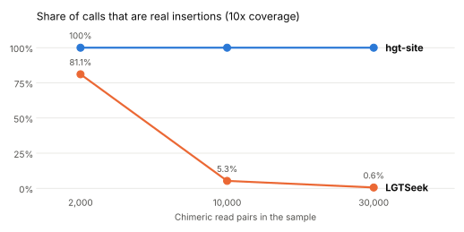
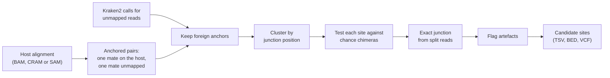
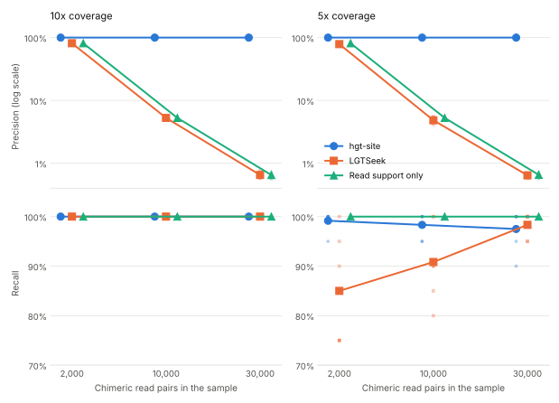
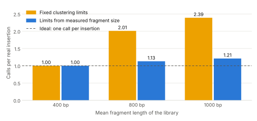
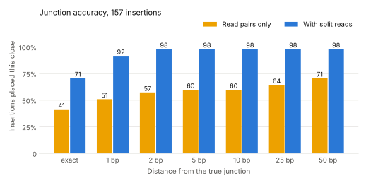
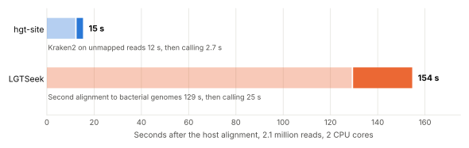
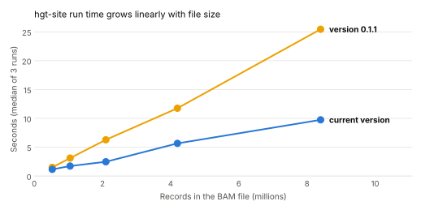

<h1 align="center">
  <picture>
    <source media="(prefers-color-scheme: dark)" srcset="docs/images/wordmark-dark.svg">
    
  </picture>
</h1>

<p align="center"><b>Your host sequencing data has bacterial or viral reads in it.<br>
Most of the positions they point to are library artefacts. This tells you which ones are not.</b></p>

<p align="center">
  <a href="https://github.com/iraajgangavaram/hgt-site/actions/workflows/tests.yml"></a>
  <a href="https://github.com/iraajgangavaram/hgt-site/actions/workflows/nightly-real-data.yml"></a>
  <a href="https://github.com/iraajgangavaram/hgt-site/releases"></a>
  <a href="https://pypi.org/project/hgt-site/"></a>
  <a href="https://bioconda.github.io/recipes/hgt-site/README.html"></a>
  <a href="https://anaconda.org/bioconda/hgt-site"></a>
  
  <a href="LICENSE"></a>
  <a href="https://doi.org/10.5281/zenodo.23842712"></a>
  <a href="https://www.repostatus.org/#active"></a>
</p>

<p align="center">
  <a href="https://iraajgangavaram.github.io/hgt-site/">Documentation</a> ·
  <a href="https://colab.research.google.com/github/iraajgangavaram/hgt-site/blob/main/examples/quickstart.ipynb">Try it in your browser</a> ·
  <a href="#installation">Installation</a> ·
  <a href="#usage">Usage</a> ·
  <a href="#output">Output</a> ·
  <a href="https://iraajgangavaram.github.io/hgt-site/interpreting/">Reading the results</a> ·
  <a href="#benchmark-on-real-genomes">Benchmarks</a> ·
  <a href="#speed">Speed</a> ·
  <a href="https://iraajgangavaram.github.io/hgt-site/for-labs/">Is it worth trying?</a> ·
  <a href="https://iraajgangavaram.github.io/hgt-site/comparison/">Other tools</a> ·
  <a href="#citation">Citation</a>
</p>

<p align="center">
  <picture>
    <source media="(prefers-color-scheme: dark)" srcset="docs/images/demo-dark.svg">
    
  </picture>
</p>

<p align="center">
  <i>112 candidate positions in that sample. Five were real. The other 107 were made in the lab.</i>
</p>

```bash
conda install -c conda-forge -c bioconda hgt-site

hgt-site run --bam sample.bam --kraken-db /path/to/kraken2-db \
    --host-taxid 9606 --threads 8 -o sites.tsv
```

```
chrom      start    end      left_breakpoint  split_reads  n_pairs  top_taxid  qvalue
chr21_20M  1870963  1871693  1871390          4            16       562        1.295e-12
chr21_20M  2646531  2646869  2646659          4            5        562        3.33e-08
```

Every candidate stays in the table with the reason it failed, so you can see what was considered and rejected. Full options under [Usage](#usage).

hgt-site detects candidate horizontal gene transfer and integration sites from short-read sequencing data. It finds places where DNA from bacteria, viruses or other organisms may have been inserted into a host genome, such as a human genome. Most bacterial reads in these samples come from contamination or from DNA fragments joined by chance in the lab, so hgt-site checks each possible site against what chance alone would produce and keeps only the sites with clearly more support. In the benchmarks below it reported no false sites across 18 runs on fresh random seeds, 364 calls in all, while an existing tool, LGTSeek, reported thousands of false sites in the noisiest samples.

It is also fast. On a sample of 2.1 million reads, hgt-site took about 3 seconds once the reads were aligned and classified, while LGTSeek needed about 2.5 minutes (see [Speed](#speed)).

Where reads cross the junction itself, hgt-site gives the insertion point to the base pair. It works with any host alignment and Kraken2 output, including the files produced by pipelines that already run Kraken2.

It is packaged on Bioconda and PyPI, with a container built from the Bioconda recipe, so there is nothing to compile and no reference bundle to download.

### What it does

- **Separates real insertions from lab artefacts.** Keep every position with enough supporting reads and you get 24,861 sites of which 390 are real. hgt-site reported 364 sites across 18 runs on fresh random seeds, with none of them false.
- **One command from a BAM.** `hgt-site run` pulls out the unmapped reads, classifies them and calls the sites.
- **Takes whatever classifier you already ran.** Kraken2, KrakenUniq, Kaiju, Centrifuge, DIAMOND, BLAST tabular, or any two-column file of read name and taxid. All six give byte-identical calls on the same reads, and there is a test that checks it.
- **Copes with uneven coverage.** `--local-background` expects more chimeras where there is more host DNA, so a copy-number gain or an amplified library does not turn into a list of false sites. On the benchmark it removed all 10 false sites a 6-copy region produced, and cost none of the real ones.
- **Or no classifier at all.** If you put the DNA there, point `--donor` at the vector, transgene or viral genome and skip the classifier and its database entirely.
- **Junctions to the base pair.** Where reads cross the junction, the insertion point is exact: 71% of junctions exact and 98% within 2 bp, against 41% and 57% from read pairs alone.
- **Tells you the gene.** Point `--annotation` at a GTF or GFF3 and every site comes back with the gene it landed in, or the nearest one.
- **Proves its own installation.** `hgt-site selftest` builds a dataset with known answers, calls it, and checks them. No data, no database, no network.
- **Three seconds** on a sample of 2.1 million reads, against about 2.5 minutes for LGTSeek.
- **Compares samples.** `hgt-site cohort` merges the tables from several samples and flags the positions that turn up in all of them, which are nearly always artefacts rather than biology.
- **Installs in one line.** On [Bioconda](https://bioconda.github.io/recipes/hgt-site/README.html) and PyPI, with a Docker and Singularity container built from the Bioconda recipe, so it drops into a pipeline without anything to set up.
- **Shows its working.** Every rejected candidate stays in the table with the reason, so you can see what was considered and thrown out.

### Who this is for

- **Anyone with foreign reads in a host sample and no way to triage them.** You have Kraken2 output from unmapped reads and a list of positions that might mean something. hgt-site tells you which positions have more support than chance would give, and flags the rest with the reason.
- **Horizontal gene transfer into host genomes.** The problem it was built for, benchmarked against LGTSeek.
- **Vectors and transgenes.** Point `--donor` at the construct and no classifier or database is needed. On simulated data, constructs of 1 kb, 3 kb and 8 kb gave 100 of 100 insertions found, nothing false and every junction exact. With a sample full of free construct, which is what a transduced culture holds, nine chance chimeras in ten carried the construct and 6,187 positions looked like candidates; the 20 real insertions were the only ones reported.
- **Viral integration.** The method works on viral taxa as well as bacterial ones, at 0.989 precision against 1.000 for a bacterial donor over eighteen runs each. It has not been compared against the dedicated viral tools, so see [other tools](https://iraajgangavaram.github.io/hgt-site/comparison/) before choosing it for that.

<p align="center">
  <picture>
    <source media="(prefers-color-scheme: dark)" srcset="docs/images/benchmark_precision_dark.svg">
    
  </picture>
</p>

<p align="center"><sub>Benchmark on real genomes with added contamination and chimeras. Read support alone gives the same numbers as LGTSeek. Details in <a href="#benchmark-on-real-genomes">Benchmark on real genomes</a>.</sub></p>

## The problem

When a sample is aligned to its host genome, some reads do not map. Kraken2 often assigns many of these to bacteria or viruses. A small number may come from real integrations of foreign DNA into the host genome, but most come from contamination or from chimeric fragments formed during library preparation, where a host fragment and a contaminant fragment are joined by chance.

A pair where one mate maps to the host and the other is foreign therefore does not show an integration on its own. The useful signal is several such pairs, from the same foreign taxon, pointing at the same host position.

## How it works



1. Collect read pairs. The host alignment is read once, and any read whose pair is fully mapped is skipped straight away. Pairs where one mate maps with mapping quality of at least 20 and the other mate is unmapped are kept as anchors. Pairs where both mates are unmapped are counted as background.
2. Keep foreign anchors. The unmapped mate's Kraken2 call is checked. Unclassified reads, the host taxon and uninformative taxa (root, cellular organisms) are removed. With an NCBI `nodes.dmp` file, the whole host lineage and the host's ancestors are removed too.
3. Cluster. Anchors are grouped by the end that faces the junction (the 3' end of a forward read, the 5' end of a reverse read), so reads from both sides of one insertion fall in the same cluster. A limit on cluster width stops scattered reads chaining together. The limits suit fragments of up to about 500 bp. For libraries with longer fragments they are widened automatically, using fragment sizes measured from the first 100,000 properly paired read pairs.
4. Test for enrichment. For each cluster, the number of pairs from its main taxon is compared with a Poisson expectation based on how many anchored pairs that taxon has across the whole genome. Chance chimeras are spread across the genome, while real integrations pile up at one place. P-values are adjusted with Benjamini-Hochberg, counting every genome window that could have produced a cluster.
5. Find the exact junction. Read pairs place a junction only to within about one fragment length. Reads that cross the junction itself align to the host up to the junction and are soft-clipped beyond it, so several clips ending at the same base give the junction to the base pair. This step needs an indexed BAM or CRAM, and only the reads around each candidate site are read. Without an index, hgt-site says so and keeps the estimate from read pairs.
6. Flag. Each site gets a filter value of `PASS` or a list of reasons it failed.

| Flag | Meaning |
|---|---|
| `LOW_SUPPORT` | Fewer than 3 supporting pairs |
| `MIXED_TAXA` | Less than 80% of pairs share one taxon, and the site holds more pairs from other taxa than background chimeras would explain |
| `LOW_MAPQ` | Mean mapping quality of the anchors below 20 |
| `LOW_COMPLEXITY` | Unmapped mates have low 3-mer entropy (repeats or low-complexity sequence) |
| `NOT_ENRICHED` | Q-value above 0.05 |
| `EXCLUDED` | Overlaps a region given to `--exclude-regions` |
| `ONE_SIDED` | Anchors from only one side of the junction (information only, does not fail a site) |

All thresholds can be changed on the command line.

## Installation

With conda or mamba, from Bioconda:

```bash
conda install -c conda-forge -c bioconda hgt-site
```

Or from PyPI:

```bash
pip install hgt-site
```

The Bioconda package also gives you a container, built automatically, which needs nothing installed at all:

```bash
docker run --rm quay.io/biocontainers/hgt-site:0.3.0--pyhdfd78af_0 hgt-site --help
```

The exact tag is on the [Bioconda page](https://bioconda.github.io/recipes/hgt-site/README.html), and a Singularity image of the same build is on the [Galaxy depot](https://depot.galaxyproject.org/singularity/).

To install the latest code from GitHub instead:

```bash
git clone https://github.com/iraajgangavaram/hgt-site.git
cd hgt-site
pip install .
```

pysam is installed as a dependency and is needed for BAM and CRAM input. Plain SAM files can be read without it.

## Usage

To check the installation before using it on anything of your own:

```bash
hgt-site selftest
```

That builds a small dataset with known insertion sites, calls it, and checks the sites that come back are the ones that were put in. It needs no data and no database, takes a few seconds, and leaves nothing behind.


To see it work before installing anything, open the quickstart notebook in Colab.
It writes its own small dataset with known insertion sites, calls them, and checks
the answers against the truth, in about a minute and with no data of your own.

[](https://colab.research.google.com/github/iraajgangavaram/hgt-site/blob/main/examples/quickstart.ipynb)

If you have a host alignment and a Kraken2 database, one command does everything:

```bash
hgt-site run \
  --bam sample.bam \
  --kraken-db /path/to/kraken2-db \
  --host-taxid 9606 \
  --threads 8 \
  -o sample.hgt-site.tsv
```

This pulls the unmapped reads out of the alignment, classifies them with Kraken2, and calls the sites. It needs `kraken2` on PATH, which comes from `conda install -c conda-forge -c bioconda kraken2`. The reads and the Kraken2 output go to a temporary folder unless you give `--workdir`, which keeps them.

If the reads have already been classified, for example by a pipeline that runs Kraken2 itself, use `call` with that output instead:

```bash
hgt-site call \
  --bam sample.bam \
  --kraken sample.kraken2.txt \
  --host-taxid 9606 \
  --nodes taxonomy/nodes.dmp \
  -o sample.hgt-site.tsv
```

`--classifications` (also accepted as `--kraken`) is the per-read output of a classifier run on the unmapped reads. Kraken2, KrakenUniq, Kaiju, Centrifuge, DIAMOND (`--outfmt 102`) and BLAST tabular output are all read directly, as is any two-column file of read name and taxid, gzipped or not. The format is worked out from the file; `--classifier` overrides it. Read names ending in `/1` or `/2` are handled, as is output made with `--use-names`. Several files can be given at once, which suits a pipeline that writes one file per read set:

```bash
hgt-site call \
  --bam results/preprocess/alignment/sample01_sorted.bam \
  --kraken results/results/classified/single_unmapped/sample01.kraken2.classifiedreads.txt \
           results/results/classified/both_unmapped/sample01.kraken2.classifiedreads.txt \
  --host-taxid 9606 \
  -o sample01.hgt-site.tsv
```

If you already know what the foreign DNA is, because you put it there, give the sequence instead of classifier output and skip the classifier entirely:

```bash
hgt-site call \
  --bam sample.bam \
  --donor vector.fa \
  --host-taxid 9606 \
  -o sample.hgt-site.tsv
```

The unmapped reads are matched against the donor by exact 31-mer matching in both orientations, at about 50,000 reads a second, and everything after that step is the same. Donor reads are reported under taxid 32630, NCBI's taxon for a built sequence, and `--donor-taxid` sets the real taxon if the donor has one. This is matching rather than alignment, so a donor diverged from your reads throughout needs a classifier instead, and a donor sharing sequence with the host will match host reads.

Other options:

| Option | What it does |
|---|---|
| `--threads 4` | Uses more cores to read large BAM or CRAM files |
| `--bed sites.bed` | Also writes the sites that passed every filter as a BED file, for genome browsers |
| `--vcf sites.vcf` | Also writes every candidate site as a VCF file, with `PASS` or the failing flags in the FILTER column. A name ending in `.gz` is compressed and indexed with tabix |
| `--annotation genes.gtf` | Reports the gene each site falls in, or the nearest gene within `--max-gene-distance` (default 100 kb). GTF or GFF3, gzipped or not |
| `--multiqc sample_mqc.json` | Also writes a summary table that MultiQC picks up, so the counts appear in a pipeline report |
| `--no-split-reads` | Skips the split-read search, so junctions come from read pairs only |
| `--nodes nodes.dmp` | Excludes the whole host lineage, not just the host taxid |
| `--reference genome.fa` | Reference FASTA, needed for CRAM input |
| `--exclude-taxid 1234` | Ignores a taxon, for example a known contaminant (can be repeated) |

While it runs, hgt-site reports how many anchored pairs it found, how many have a Kraken2 call, the fragment size it measured, and how many sites got an exact junction. If none of the anchored reads has a Kraken2 call, it warns that the Kraken2 file may not match the alignment.

To try it on simulated data with known insertion sites:

```bash
hgt-site simulate -o demo
hgt-site call --bam demo.sam --kraken demo.kraken2.txt --host-taxid 9606 -o demo.tsv
```

This writes `demo.sam`, `demo.kraken2.txt`, `demo.truth.bed` and `demo.host.fa`. The BED file holds the five insertion sites the simulator used, so the calls can be checked against them.

## Output

A tab-separated table with one row per candidate site:

| Column | Description |
|---|---|
| `chrom`, `start`, `end` | Host region covered by the anchors (0-based) |
| `left_junction`, `right_junction` | Junction estimated from forward and reverse anchors |
| `left_breakpoint`, `right_breakpoint` | Exact junction from split reads, where there are any |
| `left_split_reads`, `right_split_reads` | Reads clipped at that exact base |
| `n_pairs`, `n_forward`, `n_reverse` | Supporting pairs, split by anchor strand |
| `top_taxid`, `top_taxid_fraction`, `n_taxa` | Main foreign taxon and how consistent the calls are |
| `mean_mapq` | Mean mapping quality of the anchors |
| `mean_mate_complexity` | Mean 3-mer entropy of the unmapped mates (0 to 1) |
| `taxon_anchored_pairs` | Anchored pairs for this taxon across the genome |
| `taxon_unanchored_pairs` | Pairs for this taxon where neither mate mapped |
| `expected_pairs`, `pvalue`, `qvalue` | Enrichment test |
| `gc_foreign`, `gc_difference`, `kmer_ratio` | Base composition of the foreign reads, and how far it sits from the host's own. `kmer_ratio` is near 1 when the reads are indistinguishable from host sequence, which usually means the classifier got them wrong |
| `depth_ratio` | Host coverage at the site over the genome mean, used to scale `expected_pairs`. Always 1 unless `--local-background` was given and the local estimate was trustworthy |
| `expected_other_pairs`, `other_pvalue` | Pairs from other taxa expected by chance, and the test for an excess of them |
| `flags`, `filter` | Flags raised and the overall filter result |

With `--bed`, the sites that passed every filter are also written as BED: one line per site, named by the main taxid (for example `taxid_562`), with the number of supporting pairs as the score.

With `--vcf`, every candidate site is written as a VCF 4.2 insertion record (`ALT` is `<INS>`, `SVTYPE=INS`), so the calls can go through the same tools as other structural variants. `POS` is the last host base before the insertion, taken from the split reads where there are any and otherwise from the anchors. `QUAL` is the q-value on the phred scale, so the file can be filtered with `bcftools view -i 'QUAL>50'`. The FILTER column holds `PASS` or the failing flags. INFO holds the main taxid, the number of supporting pairs, the pairs on each side of the junction, the q-value and the split-read counts. A junction estimated from read pairs carries `IMPRECISE` with `CIPOS` and `CIEND`, which say how far the real junction could be from `POS`; a junction found in split reads is exact and carries no interval. There is one sample column with the paired and split read counts, and the header records the command and every threshold used. A name ending in `.gz` is block compressed and indexed with tabix. hgt-site does not read the reference sequence, so `REF` is `N`.

With `--multiqc`, hgt-site writes a custom-content table that MultiQC finds on its own, as long as the file name ends in `_mqc.json`. It holds the number of candidate sites, the number that passed, how many have an exact junction, and the read counts behind them.

## Preliminary results on simulated data

The simulator builds a random host genome (two 100 kb chromosomes), inserts five 1.5 to 3 kb fragments of a donor genome, and generates 100 bp paired reads with known placement. It adds free contaminant read pairs and chimeric artefact pairs that join random host positions to contaminant sequence. Results over 30 random seeds each:

| Setting | Precision | Recall |
|---|---|---|
| 10x coverage, 2,000 contaminant pairs, 150 chimeras | 1.000 | 1.000 |
| 10x coverage, 4,000 contaminant pairs, 300 chimeras | 1.000 | 1.000 |
| 5x coverage, 2,000 contaminant pairs, 300 chimeras | 1.000 | 0.980 |
| 10x, heavy noise, clusters filtered on support only (no enrichment test) | 0.217 | 1.000 |

The last row shows why the enrichment test matters: filtering on read support alone accepts most chimera clusters.

## Benchmark on real genomes

A second benchmark uses real sequence. Twenty fragments (1 to 5 kb) of the *Escherichia coli* K-12 genome were inserted into a 10 Mb region of human chromosome 21 (chr21:20,000,000-30,000,000, from nf-core/test-datasets). Paired 150 bp reads were simulated with wgsim. The reads were mixed with 50,000 free contaminant read pairs from *Klebsiella pneumoniae*, *Salmonella enterica*, *Pseudomonas aeruginosa* and *Acinetobacter baumannii*, and with host-contaminant chimeric pairs of the kind formed during library preparation. Reads were aligned to the host with BWA-MEM and the unmapped reads were classified with Kraken2, using a database built from the host region and the five bacterial genomes.

hgt-site was compared with two approaches on the same data:

- Support only: the same clusters, accepted when they have at least 3 supporting pairs, with no enrichment test.
- LGTSeek: the read classification step of LGTSeek (`LGT::LGTSeek->bwaPostProcess` from [IGS/lgtseek-pipeline](https://github.com/IGS/lgtseek-pipeline)), with reads aligned to the host and to the five bacterial genomes. LGTSeek reports read pairs rather than sites, so its host-side reads were grouped with the same clustering settings and a site needed at least 3 pairs.

Results over 3 random seeds per setting (60 true insertions per row):

| Coverage | Chimeric pairs | hgt-site precision | hgt-site recall | LGTSeek precision | LGTSeek recall | Support-only precision | Support-only recall |
|---|---|---|---|---|---|---|---|
| 10x | 2,000 | 1.000 | 1.000 | 0.813 | 1.000 | 0.813 | 1.000 |
| 10x | 10,000 | 1.000 | 1.000 | 0.053 | 1.000 | 0.053 | 1.000 |
| 10x | 30,000 | 1.000 | 1.000 | 0.007 | 1.000 | 0.007 | 1.000 |
| 5x | 2,000 | 1.000 | 0.983 | 0.781 | 0.817 | 0.813 | 1.000 |
| 5x | 10,000 | 1.000 | 0.983 | 0.047 | 0.883 | 0.053 | 1.000 |
| 5x | 30,000 | 1.000 | 0.983 | 0.007 | 0.983 | 0.007 | 1.000 |

As chimeras become more common, approaches based on read support alone report thousands of candidate sites, of which fewer than 1% are real. hgt-site kept every call correct across all settings. The one insertion it missed at 5x coverage came from a region shared between *E. coli* and *K. pneumoniae*, where Kraken2 split the reads between the two species.

### Independent simulator

To check that the results do not depend on how our own script places insertions, the benchmark was repeated with the integration simulator of Scott et al. (2022), from [aehrc/vector-integration-simulation-pipeline](https://github.com/aehrc/vector-integration-simulation-pipeline). Its insertion model adds rearranged and partly deleted fragments, deletions of host sequence at the site, and small gaps or overlaps at the junctions, and it places insertions with its own position model. It was run with *E. coli* fragments of 1 to 5 kb, no whole-genome insertions and no free episomes. Reads, contamination, chimeras, alignment and classification were the same as above, on 3 new random seeds per setting:

| Coverage | Chimeric pairs | hgt-site precision | hgt-site recall | LGTSeek precision | LGTSeek recall | Support-only precision | Support-only recall |
|---|---|---|---|---|---|---|---|
| 10x | 2,000 | 1.000 | 1.000 | 0.811 | 1.000 | 0.811 | 1.000 |
| 10x | 10,000 | 1.000 | 1.000 | 0.053 | 1.000 | 0.053 | 1.000 |
| 10x | 30,000 | 1.000 | 1.000 | 0.006 | 1.000 | 0.006 | 1.000 |
| 5x | 2,000 | 1.000 | 1.000 | 0.791 | 0.883 | 0.811 | 1.000 |
| 5x | 10,000 | 1.000 | 0.983 | 0.050 | 0.933 | 0.053 | 1.000 |
| 5x | 30,000 | 1.000 | 0.967 | 0.006 | 0.983 | 0.006 | 1.000 |

The pattern matches the first benchmark. The three insertions hgt-site missed at 5x coverage were again fragments whose reads Kraken2 split between *E. coli* and *K. pneumoniae*.

The simulator needs Biopython 1.77. For these runs, the few Biopython functions it uses (FASTA reading, sequence slicing and reverse complement) were supplied by a small compatibility module, which passed the simulator's own test suite.

The figure below shows both benchmarks together: 6 random seeds per setting, 3 with each simulator, with 20 true insertions in each. Small points are single runs and lines join the means. Precision is on a log scale, because the other two approaches fall below 1% while hgt-site stays at 100%.

<p align="center">
  <picture>
    <source media="(prefers-color-scheme: dark)" srcset="docs/images/benchmark_accuracy_dark.svg">
    
  </picture>
</p>

### Libraries with long fragments

Reads from one insertion lie within about one fragment length of the junction, so with fixed clustering limits, libraries with long fragments can have one insertion split into two candidate sites. hgt-site measures the fragment size from properly paired reads and widens its limits when needed. The built-in simulator was run with mean fragment lengths of 400, 800 and 1000 bp (20 random seeds each, 5 insertions per seed, 300 chimeric pairs and 4,000 contaminant pairs):

<p align="center">
  <picture>
    <source media="(prefers-color-scheme: dark)" srcset="docs/images/benchmark_fragments_dark.svg">
    
  </picture>
</p>

Both settings found every insertion. With fixed limits, most insertions in the 800 and 1000 bp libraries were reported twice, and precision at 1000 bp was 85%. With limits set from the measured fragment size, precision was 100% at 800 bp and 97.5% at 1000 bp. At 400 bp the limits are not changed and the results are identical.

### Junction accuracy

Read pairs place a junction only to within about one fragment length, so hgt-site also looks for reads that cross the junction and are soft-clipped past it. This was measured on 8 runs of the real-genome benchmark (10x and 5x coverage, 2,000 and 30,000 chimeric pairs, 2 seeds each), using the full sorted alignment rather than one filtered down to pairs with an unmapped mate. Across the 157 sites that matched a true insertion, split reads were found for 154.

<p align="center">
  <picture>
    <source media="(prefers-color-scheme: dark)" srcset="docs/images/benchmark_junctions_dark.svg">
    
  </picture>
</p>

With split reads, 71% of junctions were exact and 98% were within 2 bp, against 41% exact and 57% within 2 bp from read pairs alone. The remaining 2% are the three sites with no split reads, where the estimate from read pairs is kept. The same sites passed the filters either way, and the extra step made no measurable difference to the run time, because only the sites that passed every other filter are searched and the alignment index is used to read just the reads around them.

## Other tools in this area

| Tool | Latest tagged release | Last commit |
| --- | --- | --- |
| [LGTSeek](https://github.com/rileydavidr/lgtseek) | v1.08, January 2015 | June 2016 |
| [IGS lgtseek-pipeline](https://github.com/IGS/lgtseek-pipeline) | none tagged | February 2022 |
| hgt-site | 0.2.0, November 2026 | actively developed |

Read from the repositories on 2 November 2026.

LGTSeek is the tool hgt-site is benchmarked against, and it has had no commit for
nine years, so getting it to run at all now takes work. Pipelines that align
reads and classify the unmapped ones solve a different part of the problem and
produce the input hgt-site takes, rather than calling sites themselves.

## Speed

hgt-site only needs read pairs where at least one mate is unmapped, and it skips every other read before doing any work on it. It reads the host alignment once and needs no second alignment.

Measured on one sample of 2.1 million paired reads (1 million pairs from human chr21:20,000,000-30,000,000 and 50,000 contaminant pairs, aligned with BWA-MEM), on 2 CPU cores:

| Step after the host alignment | hgt-site | LGTSeek |
|---|---|---|
| Kraken2 on the unmapped reads | 12 s | not needed |
| Second alignment of all reads to the bacterial genomes | not needed | 129 s |
| Calling sites or classifying reads | 2.7 s | 25 s |
| Total | 15 s | 154 s |

<p align="center">
  <picture>
    <source media="(prefers-color-scheme: dark)" srcset="docs/images/benchmark_speed_dark.svg">
    
  </picture>
</p>


hgt-site times are the median of five runs. Where a pipeline has already run Kraken2, hgt-site adds about 3 seconds for a sample of this size. Compared with version 0.1.1, the calling step is more than twice as fast on the same file (median 5.9 s before, 2.7 s now), with identical results.

Run time grows in proportion to the size of the alignment file. The same sample was subsampled to about 0.5 and 1 million records and concatenated to 4.2 and 8.4 million records, and each file was run three times with each version:

<p align="center">
  <picture>
    <source media="(prefers-color-scheme: dark)" srcset="docs/images/benchmark_scaling_dark.svg">
    
  </picture>
</p>

At 8.4 million records the current version took a median of 9.8 s, against 25.5 s for version 0.1.1, or about 0.9 million records a second. At that rate, a 100-million-read exome takes roughly two minutes. Times vary by about 10% between runs of the same file.

### Reproducing the benchmarks

The scripts are in [`benchmark/`](benchmark/). `run_benchmark.py` runs one replicate, `summarise.py` builds the table from a folder of runs, and `figures.py` draws the figures in this README. The numbers behind each figure are in [`benchmark/results/`](benchmark/results/). Add `--intvi-script` with the path to the simulator's `scripts/insert_virus.py` to use the independent simulator, and `--lgtseek-lib` with LGTSeek's `perl5` library folder to include LGTSeek.


The simulated datasets, the known insertion sites and the full results for all 18 runs are packaged as a single archive, with one ready-to-run dataset included so another tool can be scored on the same data without rebuilding anything: [hgt-site-benchmark-v1.0.0.tar.gz](https://github.com/iraajgangavaram/hgt-site/releases/download/0.3.0/hgt-site-benchmark-v1.0.0.tar.gz). Its README explains the design and how to score a different tool against it.

## Limitations

- The simulator models alignment and Kraken2 classification directly rather than running an aligner and classifier, and its genomes are random sequence without repeats.
- The real-genome benchmark uses real sequence but simulated reads, a Kraken2 database far smaller than a standard one, and chimeras placed at random positions. Real data may include chimera hotspots and more reads classified above species level.
- The LGTSeek comparison covers its read classification step only, not its later BLAST-based filtering.
- Sites are tested one taxon at a time, so an insertion whose reads Kraken2 splits between related species can lose support. Grouping Kraken2 calls at genus or family level before testing was tried and did not help: genus grouping changed nothing in the benchmark, and family grouping merged real insertions with contamination from related bacteria, which lowered recall.
- Fragment sizes are measured from properly paired reads, so if the input contains only pairs with an unmapped mate, the default clustering limits are used.
- Exact junctions need an indexed alignment that still holds the reads whose pairs are fully mapped. They are found for fewer sites at low coverage, and for none when the input has been filtered down to pairs with an unmapped mate.
- The speed comparison used five bacterial genomes as LGTSeek's reference, and the time for its second alignment depends on the size of that reference. All timings were measured on one 2-core machine and will differ on other hardware.
- Across every benchmark run, including earlier versions of the code, one false site appeared in 4 of 59 simulated datasets, all of them in the samples with the fewest chance chimeras. The raw results are in the repository.
- A single insertion is occasionally reported as two neighbouring sites. This happened to one insertion in 4 of 18 runs on fresh seeds.

## Future work

- Test on public sequencing data, including the datasets used to evaluate existing HGT pipelines
- Combine reads that Kraken2 splits between related taxa without merging them with contamination
- Submit the Galaxy wrapper in [`galaxy/`](galaxy/) to the Tool Shed and the Nextflow module in [`nextflow/`](nextflow/) to nf-core/modules, both now possible since the Bioconda package provides the container they need

## Testing

```bash
pip install ".[test]"
pytest
```

35 tests cover the units, the simulated data, BAM and CRAM input, the output formats, the exact junctions and that results do not depend on the order of records in the file. They run on GitHub for Python 3.10 to 3.13. Code style is checked with `ruff check src tests benchmark`.

## Using it from Python

Everything the command line does is available as a library:

```python
from hgt_site import call_sites, passed, to_dataframe

sites = call_sites("sample.bam", ["classified.txt"], host_taxid=9606)
frame = to_dataframe(passed(sites))
```

`call_sites` returns every candidate, not just the ones that passed, so a rejected position can still be inspected. See the [API reference](https://iraajgangavaram.github.io/hgt-site/api/).

## Contributing

Bug reports, criticism of the method and runs on real data are all welcome, and there is no need to ask first. See [CONTRIBUTING.md](CONTRIBUTING.md).

The most useful thing anyone can send is a run on real sequencing data, including one that found nothing. There is an [issue template](https://github.com/iraajgangavaram/hgt-site/issues/new?template=real_data_report.yml) for it that asks about the sample and the output and nothing about the data itself. Reports that go into the documentation are credited by name.

If hgt-site is useful to you, starring the repository helps other people find it.

## Use of generative AI

hgt-site is led by Iraaj Gangavaram, who chose the project from the options considered, set its scope, and made the decisions on its programming language, licence, benchmarking and comparison with LGTSeek. He reviewed and approved every change before it was committed. Claude (Anthropic), a generative AI assistant (Claude Opus 5.5), was used to write most of the source code, tests and benchmark scripts, to draft the documentation including this README, and to run and summarise the benchmarks. The methods were checked with the automated tests and the benchmarks reported above.

## Citation

If you use hgt-site in your work, please cite it. Use the "Cite this repository" button on the GitHub page, or the details in [CITATION.cff](CITATION.cff).

## Author

Iraaj Gangavaram ([ORCID 0009-0002-4615-2846](https://orcid.org/0009-0002-4615-2846))

## Licence

MIT. See [LICENSE](LICENSE).
