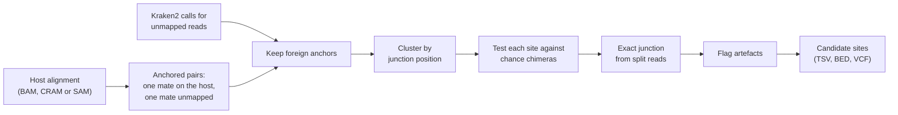

# How it works

## 1. Collect read pairs

The host alignment is read once, and any read whose pair is fully mapped is skipped straight away. In a typical host alignment those are well over 99% of the records, which is most of why hgt-site is quick.

Pairs where one mate maps with mapping quality of at least 20 and the other mate is unmapped are kept as anchors. Pairs where both mates are unmapped are counted as background: they say how much of each taxon is in the sample without saying where it sits.

## 2. Keep foreign anchors

The unmapped mate's Kraken2 call decides whether a pair is of interest. Unclassified reads, the host taxon and uninformative taxa (root, cellular organisms) are removed. With an NCBI `nodes.dmp` file, the whole host lineage and the host's ancestors are removed too, so a read assigned to Primates rather than to human is still ignored.

## 3. Cluster

Anchors are grouped by the end that faces the junction: the 3' end of a forward read, the 5' end of a reverse read. Reads from both sides of one insertion therefore fall in the same cluster. A limit on cluster width stops scattered chimeric reads chaining into one long false cluster.

The default limits suit fragments of up to about 500 bp. For libraries with longer fragments they are widened automatically, using fragment sizes measured from the first 100,000 properly paired read pairs. Without this, one insertion in a long-fragment library is often reported twice (see [Benchmarks](benchmarks.md)).

## 4. Test for enrichment

This is the step that separates real insertions from chance chimeras.

Chimeras formed during library preparation join a host fragment to a contaminant fragment at an arbitrary host position, so they are spread across the genome. A real integration puts many pairs at one place. For each cluster, the number of pairs from its main taxon is compared with a Poisson expectation: how many pairs of that taxon would land in a window this size if the taxon's anchored pairs were spread at random across the host genome.

P-values are adjusted with Benjamini-Hochberg. The number of tests counts every genome window that could have produced a cluster for every taxon present, not only the windows where a cluster was seen, since counting only the observed clusters would make the correction too lenient.

## 5. Find the exact junction

Read pairs place a junction only to within about one fragment length. Reads that cross the junction itself align to the host up to the junction and are soft-clipped beyond it, so several clips ending at the same base give the junction to the base pair.

On the side covered by forward anchors the host sequence ends at the junction, so crossing reads are clipped on their right; on the other side they are clipped on their left. The two positions can differ by a few bases when the insertion duplicated or deleted host sequence, and both are reported.

This step needs an indexed BAM or CRAM, so that only the reads around each candidate site are read. Without an index, hgt-site says so and falls back to the estimate from read pairs.

## 6. Flag

Each site gets a filter value of `PASS` or a list of reasons it failed. The [flags are listed in Output](output.md#flags), and every threshold can be changed on the command line.
